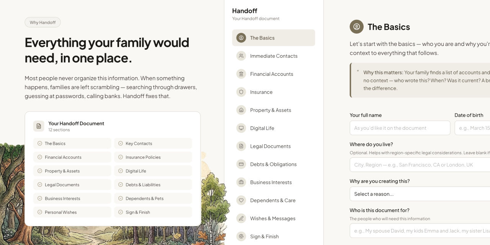

<h1>Handoff</h1>

Organize the accounts, documents, contacts and wishes your family would need. 
Complete it privately, then export one document you control.

  
  
  
  

<a href="https://handoff.santiagoalonso.com">Try it live</a>

Handoff walks you through the information an estate attorney would ask for, so the people you leave behind aren't searching drawers and guessing passwords.

- Twelve guided sections, from key contacts and accounts to digital life and personal wishes.
- Everything stays in your browser until you download it.
- Export a formatted PDF or Markdown file, in English or Spanish.

## How it works

Work through the sections in any order: contacts, financial accounts, insurance, property, digital life, legal documents, debts, business interests, dependents and pets, personal wishes, then sign and finish. Review the result and download it as a PDF or Markdown file. The interface, the review step and the export all follow the language you pick. What each section covers is in [docs/sections.md](docs/sections.md).

## Privacy

No account, no server, no analytics, and fonts are self-hosted, so the page makes no outside requests. Your answers are saved in your browser and leave only when you download the document. You can clear them at any time.

## Install

Use it at [handoff.santiagoalonso.com](https://handoff.santiagoalonso.com), or run it locally with `npm install` and `npm run dev`. It's React 19 and Vite, with jsPDF loaded only when you export, and tests in Vitest and Playwright.

---

[MIT](LICENSE)

Made by [santiagoalonso.com](https://santiagoalonso.com)
